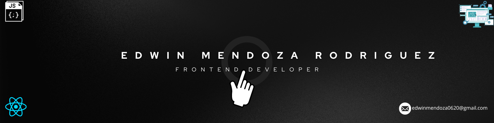

<h1 align="left">
  Hello ,
  I'm Edwin Mendoza Rodríguez, Frontend Developer
</h1>

  <b>React · Next.js · TypeScript</b>: building secure, scalable financial products for the banking industry.

<h3>About me</h3>

Frontend Developer at a <b>banking institution</b>, building the interfaces behind critical financial operations: digital onboarding flows, credit and loan simulators, and internal platforms used every day.  

My day-to-day stack is <b>React, Next.js (App Router) and TypeScript</b>, with <b>TanStack Query</b> for server state, <b>Zustand</b> for client state, and <b>MUI</b> for UI.  

I'm building a company-wide <b>Design System</b> on top of MUI: wrapped components, theming, a Turborepo monorepo, tsup builds, Storybook docs, and distribution through a private package registry.  

I care about clean architecture: business logic in <b>custom hooks</b> and <b>pure, testable utilities</b>, typed API contracts, and a clear split between frontend calculations and backend-driven data.  

Working in finance means security and reliability come first: authentication flows, session handling, OTP verification and integration with APIs exposed through <b>Azure API Management</b>.  

Outside the bank, I run <a href="https://nuvixweb-landing-page.vercel.app"><b>NuvixWeb</b></a>, my own web development brand, and I'm finishing my university degree.

 

<h3 align="left">Tech Stack</h3>

<b>Core</b>

  
  
  
  

<b>State & Data</b>

  
  
  
  

<b>UI & Design System</b>

  
  
  
  

<b>Tooling & Workflow</b>

  
  
  
  
  
  

 

<h3 align="left">What I Work On</h3>

<ul>
  <li><b>Banking products:</b> digital onboarding and credit/loan simulators with real-time payment calculation.</li>
  <li><b>Design System:</b> reusable, themeable MUI-based component library documented in Storybook.</li>
  <li><b>API integration:</b> typed contracts, caching and synchronization with TanStack Query.</li>
  <li><b>Security:</b> authentication, session management and OTP flows behind Azure API Management.</li>
  <li><b>Architecture:</b> custom hooks, pure utilities, monorepos and code quality gates with SonarQube.</li>
  <li><b>Agile delivery:</b> working in Scrum teams with Jira.</li>
</ul>

 

<h3 align="center">GitHub Stats</h3>

  
  
<i>Most of my professional work lives in private enterprise repositories.</i>

<h3>Contact Me</h3>

<i>Open to connecting and talking about frontend, design systems and fintech.</i>

  
  
  

